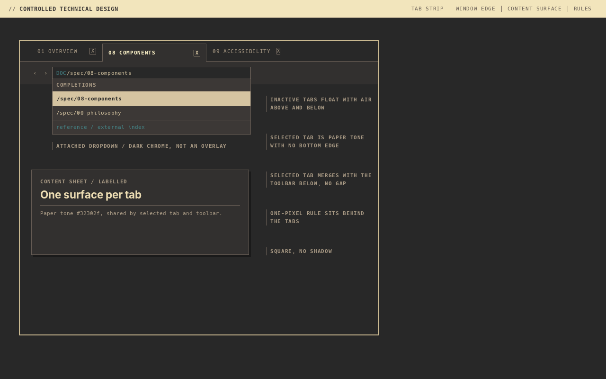
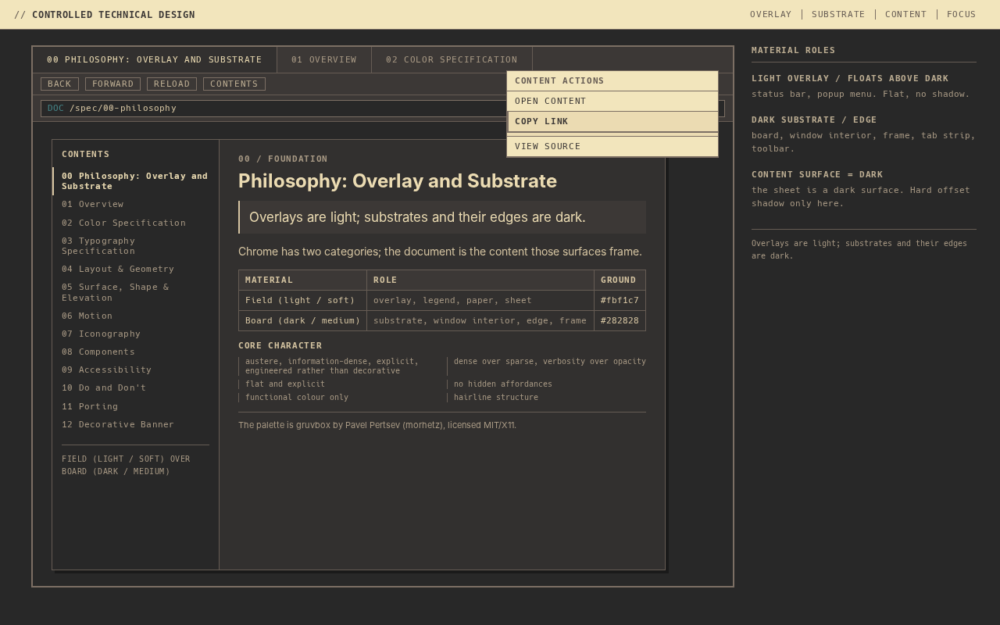

# Controlled Technical Design

A visual language governed by a controlled vocabulary, a restricted palette
with fixed semantic meanings, two fixed type roles, and hairline structure,
arranged so a surface reads as an unambiguous technical document rather than a
decorated interface.

## Preface

This "design specification" was generated by an LLM, using my already made
themes and my extensive descriptions as a base. Even though this was generated
by an LLM, I've attempted to take great care to ensure that it follows
my own personal vision.

---

**Status:** v1.0, settled
**Version:** 1.0
**Scope:** complete design system specification (philosophy, tokens,
components, recognition)
**Palette:** gruvbox (MIT/X11); see [ATTRIBUTION.md](ATTRIBUTION.md).

---

## Foundation

Controlled Technical Design rests on **Overlay and Substrate**, stated in one
line:

> Overlays are light; substrates and their edges are dark.

Every layer of an interface is either a light overlay (a printed legend) or a
dark substrate and edge (a board), and that single axis determines its material,
focus behavior, and motion. The full reasoning, the layer flow, the four
corollaries, and the normative contrast budget, is in
[spec/00-philosophy.md](spec/00-philosophy.md), which governs the rest of the
specification.

## What this is

Controlled Technical Design (CTD) is a standalone specification for building
interfaces that read as technical documents. It begins with the Overlay and
Substrate foundation: every surface is classified as a light overlay or a
dark substrate/edge, and that role fixes its material and behavior. On top of
that it fixes a small, closed set of colors with defined semantic meaning, two
type roles, and a hairline structural grammar, then governs how these combine
into components. The result is an austere, information-dense, explicit surface
engineered rather than decorative. CTD can be realized in any rendering
technology; this specification defines the visual and behavioral contract, not a
particular codebase.

## Design principles

- **Overlay and Substrate.** Every layer asks one question first: substrate or
  overlay? The answer fixes its material, edge, focus behavior, and motion. No
  layer is left ambiguous.
- **Controlled vocabulary.** Color, type, and structure are restricted to a
  fixed set of roles, each with one meaning. No ad-hoc additions.
- **Density over emptiness.** Dense over sparse, verbosity over opacity.
  Whitespace-heavy minimalism is deliberately rejected.
- **Flat and explicit.** No hidden affordances. Controls are word-labelled;
  state is visible; nothing relies on discovery.
- **Functional colour only.** Color carries semantic state and never
  decoration: urgent (red) and attention (yellow) only. There are no module
  colors and no second focus hue.
- **Hairline structure.** One-pixel solid borders and dotted rules define
  containers and sections. The single hard offset shadow is reserved for the
  content sheet.
- **Two-material model.** Dark content surfaces (boards) under light,
  paper-like overlays and legend, "printed legend on a dark board," expressed
  as the overlay/substrate axis above.
- **Contrast budget.** Only one thing spends the most contrast at a time: one
  active board and one active element. Fields spend least; color labels state.
- **A system, not a theme.** These are rules for a family of surfaces, not a
  recoloring applied after the fact. Components derive from the same tokens and
  contract.

## Atlas examples

Two rendered examples from the atlas; the full set lives in
[examples/README.md](examples/README.md).

*Tab strip: an active tab in paper tone, flush with its page;
inactive tabs stay dark.*

*Overlay and substrate: light chrome over a dark content sheet.*

## Spec structure

| File | Description |
| --- | --- |
| `README.md` | Front door: definition, foundation, status, principles, file index, and recognition. |
| `ATTRIBUTION.md` | Credits for the gruvbox palette and the referenced (not redistributed) typefaces, with license notices. |
| `spec/00-philosophy.md` | Foundation: Overlay and Substrate premise, core statement, layer flow, four corollaries, normative contrast budget, and scope. |
| `spec/01-overview.md` | Character, controlled-vocabulary metaphor, goals and non-goals. |
| `spec/02-color.md` | Palette, semantic color roles, and the controlled color contract (state-only color; two-layer focus, not a focus hue). |
| `spec/03-typography.md` | The two fixed type roles (plus the optional content role), stacks, sizes, weights, and measures. |
| `spec/04-layout.md` | Grid, content frame, rail, status bar, geometry, spacing rhythm, and breakpoints. |
| `spec/05-surface-and-shape.md` | Zero radius, hairline structure, the single sanctioned hard offset shadow, and functional accents. |
| `spec/06-motion.md` | The single schematic easing curve, allowed structural transitions, durations, and reduced-motion behavior. |
| `spec/07-iconography.md` | Where glyphs are permitted, word-labelled controls, and the ban on decorative icons. |
| `spec/08-components.md` | Structural descriptions of frames, rails, bars, panels, buttons, tables, callouts, and figures. |
| `spec/09-accessibility.md` | Two-layer focus indicators, semantic state, reduced motion, color-plus-label, and contrast. |
| `spec/10-do-and-dont.md` | Condensed guidance, rationale, and common failure modes. |
| `spec/11-porting.md` | Porting to a new surface or theme: decision procedure, token wiring map, characteristics checklist, and naming. |
| `spec/12-decorative-banner.md` | The banner as the single named decorative exception: contour field, wordmark treatments, background use, and examples. |
| `tokens/tokens.css` | CSS custom-property token definitions (primitive and semantic). |
| `tokens/tokens.json` | Machine-readable token definitions mirroring `tokens.css`. |

## Recognition

A surface is recognisably CTD to the extent it follows these rules. There is
no obligation to adopt them; they describe the design language. Adapt freely;
the closer the match, the more clearly the result reads as CTD.

For applying these rules to a new application, toolkit, or theme engine, see
[spec/11-porting.md](spec/11-porting.md). For the decorative banner exception,
see [spec/12-decorative-banner.md](spec/12-decorative-banner.md).

## Attribution

The color scheme is gruvbox by Pavel Pertsev (morhetz), licensed MIT/X11. Full
notice and typeface credits: [ATTRIBUTION.md](ATTRIBUTION.md).
