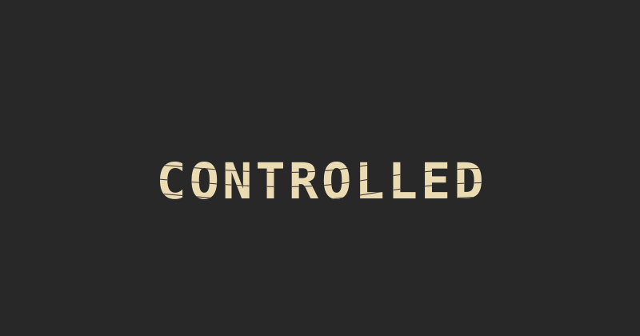
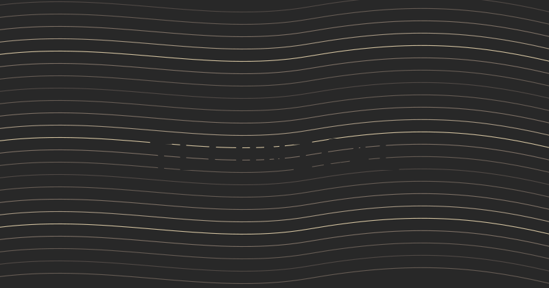
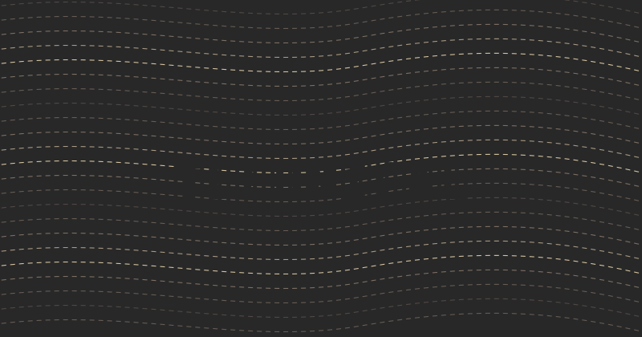
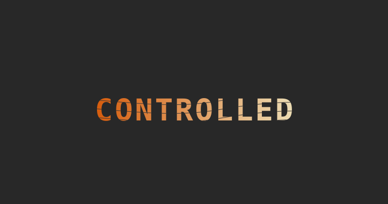
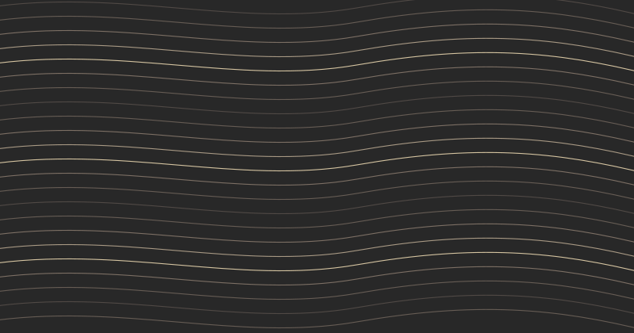
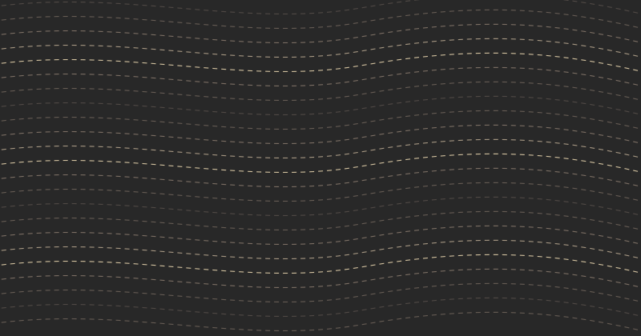

# Decorative Banner

**Status:** v1.0, settled
**Version:** 1.0
**Scope:** the startup and showcase banner as a named decorative exception
**Palette:** gruvbox (MIT/X11); see [ATTRIBUTION.md](../ATTRIBUTION.md).

---

## Introduction

The banner is the one element in CTD permitted to be decorative, visual for
its own sake. It is an explicit, named exception to the usual rules that color
is never decorative and that surfaces carry no decorative icons. A banner is
not a functional label and not a status surface: it announces no state,
reports no value, and carries no control. Everywhere else the closed color
language and the no-decoration rule still hold.

Even as an exception, a banner stays inside the system. It uses only the
gruvbox palette, keeps the geometry and spacing of the layout, and follows
the same material rules as every other surface: flat, opaque, hard-edged, and
free of blur, translucency, and decorative shadow.

---

## The contour field

The field is a set of wavy hairlines drawn across the banner, one fine line
below the next, reading like a topographic contour or an `"ASCII-like"`
texture. The lines sit in the neutral ramp of the palette:

- `#504945`
- `#665c54`
- `#7c6f64`
- `#a89984`
- `#d5c4a1`

The field can be solid, with every line drawn without a break, or dashed, with
the lines broken into short repeating strokes for an `"ASCII-like"` grain.
Stroke weight stays hairline; the lines are the texture, not a border. The
ramp can step through its values in order or repeat, but it introduces no hue
outside the neutral set.

---

## Wordmark treatments

The wordmark is the banner's word, set in the monospace structural face (Hack,
with monospace fallbacks) and treated in one of four ways:

- **Solid ink.** The word is filled in ink `#ebdbb2` over the field.
- **Flat tonal split.** The word is split across a single axis into two flat
  neutral tones, with a hard edge between them.
- **Negative / knockout.** The word is carved out of the field as a void: the
  contour lines are masked away inside the letterforms, so the word reads as
  the background showing through.
- **Two-color.** One hue runs to ink across a single axis, for example
  gruvbox orange `#d65d0e` to ink `#ebdbb2`. This is the one two-stop
  transition the banner allows; it appears nowhere else in the element.

---

## The word as identity

The word is identity only: it names the thing the banner stands for and adds
nothing else. A banner introduces no fabricated metadata: no version strings,
no dates, no fake labels, no invented status or count. The wordmark stays
word-labelled; a glyph never takes the place of the word.

---

## Background use

The field can be used on its own, with no wordmark, as a background behind
content. In this role it is kept quiet: a low-contrast neutral texture that
sits behind the material and never reads as a surface of its own. Content
stays fully legible over it, and the field never competes with the text or
controls placed on top.

---

## Examples

Topographic wordmark (contour lines clipped to a solid-ink word):

Negative knockout (the word carved out of a field):

Dashed knockout (an ASCII-like field with the word carved out):

Two-color wordmark (one hue running to ink across one axis):

Knockout field alone (a quiet background, no wordmark):

Dashed field alone (a quiet ASCII-like background):

---

## Constraints

A banner draws only from the gruvbox palette, using the neutral ramp plus the
ink value and the single accent hue of the two-color treatment. It is flat:
there are no gradients except the single two-stop axis of the two-color
wordmark. Edges are hard, corner radius is zero, and there is no shadow, blur,
or translucency. No fabricated text appears anywhere on it. The wordmark stays
word-labelled. Used as a background, the field stays quiet and never competes
with the content in front of it.

---

## Do and Don't

**Do**

- The banner is openly decorative, the single named exception in CTD.
- Its colors come from the gruvbox palette and the neutral ramp.
- CTD uses flat tonal steps, hairline contours, and hard edges here.
- The field can run solid or dashed for an `"ASCII-like"` texture.
- The wordmark stays word-labelled and is identity only.
- As a background, the field can sit quietly behind content.

**Don't**

- Fabricated metadata, fake labels, and version strings have no place here.
- CTD adds no shadow, blur, translucency, or rounded corners to a banner.
- The field introduces no hue outside the neutral ramp and the one accent.
- No gradient appears except the single two-stop wordmark axis.
- A background field never competes with the content over it.
